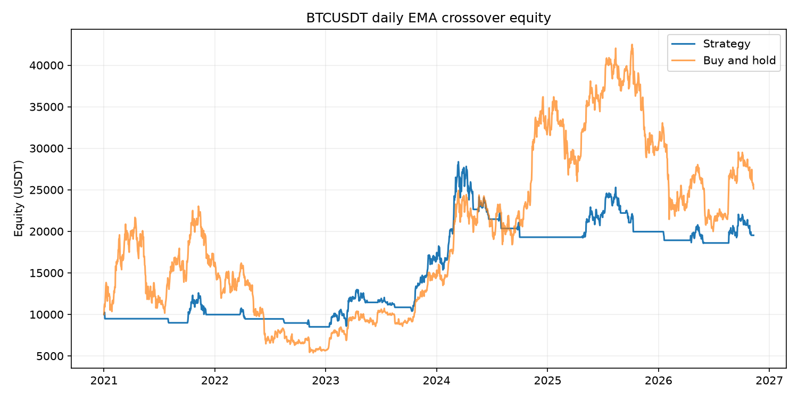
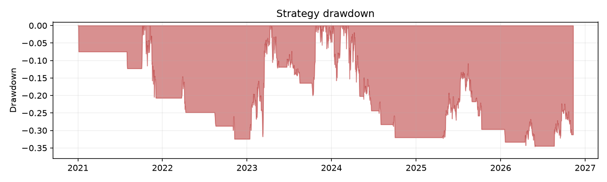

# EMA Crossover Backtest Sample

**Sample project for research and demonstration only. Not financial advice. No live trading.**

This project rewrites a small Pine Script v5 EMA crossover strategy as a transparent Python/pandas daily-bar backtest. It uses public BTCUSDT candles, applies a fixed percentage stop, and writes a Markdown summary, CSV files, and charts. It does not connect to exchange trading endpoints.

## Pine to Python

| Pine Script | Python implementation |
|---|---|
| `ta.ema(close, length)` | `ewm(span=length, adjust=False)`, seeded by the first close |
| `ta.crossover(a, b)` | `a > b` now and `a[1] <= b[1]` on the prior bar |
| `ta.crossunder(a, b)` | `a < b` now and `a[1] >= b[1]` on the prior bar |
| Default `process_orders_on_close=false` | Signals schedule orders for the next candle's open |
| `commission_value=0.1` | 0.1% charged on entry and exit notional |
| `slippage=0` | Zero ticks by default; configurable in `Config` |
| `strategy.exit(stop=...)` | Stop checked against the candle low; gap-through fills at open, otherwise at stop price |

The Pine source is [`pine/ma_crossover.pine`](pine/ma_crossover.pine). The Python implementation is long-only and uses 100% of available cash per entry. Stop orders become active after the entry bar, consistent with the close-based strategy calculation model.

## Run

```bash
python3 -m venv .venv
.venv/bin/pip install -r requirements.txt
.venv/bin/pytest -q
.venv/bin/python -m sample.run --offline
.venv/bin/python -m sample.run
```

Offline mode reads [`data/sample_btcusdt_1d.csv`](data/sample_btcusdt_1d.csv), a 300-candle subset fetched from Binance's public Kline endpoint (`api.binance.com/api/v3/klines`, BTCUSDT, 1d). Online mode requests the available daily history from 2021-01-01. Network errors are reported and stop the run; online mode never silently substitutes local data.

Offline runs write to `reports/offline/`; online runs write to `reports/online/`. Each directory contains `report.md`, `trades.csv`, `equity.csv`, `equity.png`, and `drawdown.png`, so running one mode never replaces the other mode's results.

## Example output

Latest online sample (data through **2026-11-10**):

| Metric | Strategy | Buy and hold |
|---|---:|---:|
| Total return | 95.23% | 151.21% |
| Annualized return | 12.10% | — |
| Maximum drawdown | -34.59% | — |
| Sharpe (daily, 365 days) | 0.546 | — |
| Win rate (closed trades) | 27.78% | — |
| Closed trades | 18 | — |

The strategy underperformed buy and hold in this sample. The example demonstrates a transparent, reproducible conversion process; it does not demonstrate superior returns. These figures can change when Binance adds or revises candles.





## How to verify against TradingView

Add [`pine/ma_crossover.pine`](pine/ma_crossover.pine) to a TradingView chart for `BINANCE:BTCUSDT` on the 1D timeframe. Export the strategy **List of Trades**, then compare each entry and exit date and price with [`reports/online/trades.csv`](reports/online/trades.csv). The EMA warm-up initialization may differ from TradingView's built-in implementation, so verify the signals on the first several candles against the actual chart and exported trades. This sample has not been independently checked against TradingView.

## Limitations

- Daily OHLC data cannot reveal the true sequence of intraday prices. A stop touched within a candle is modeled at the stop level, except a gap through it fills at the open.
- The sample omits funding, taxes, exchange outages, liquidity constraints, and market impact. Slippage is zero by default.
- It assumes a full-cash, long-only position and does not model shorting or partial fills.
- Sharpe uses daily returns and 365 periods per year; short offline histories make annualized statistics especially unstable.
- Historical results are not forecasts. This is educational research code, not a production or live-trading system.

## License

MIT. See [`LICENSE`](LICENSE).
